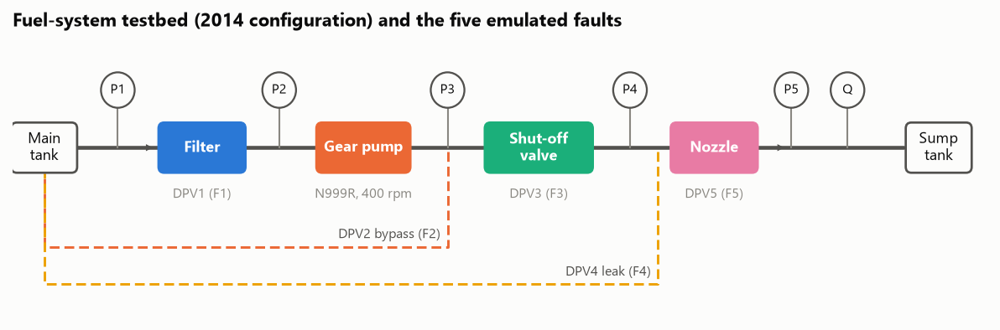
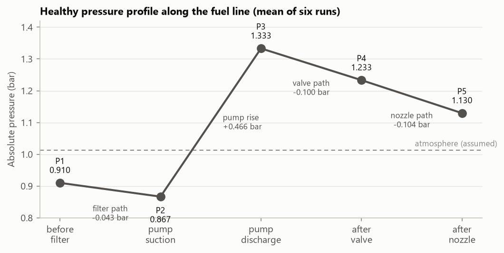
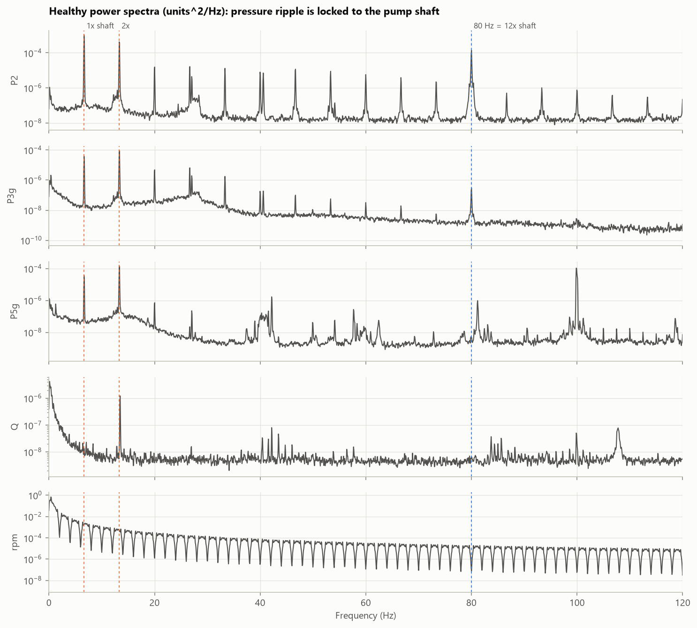
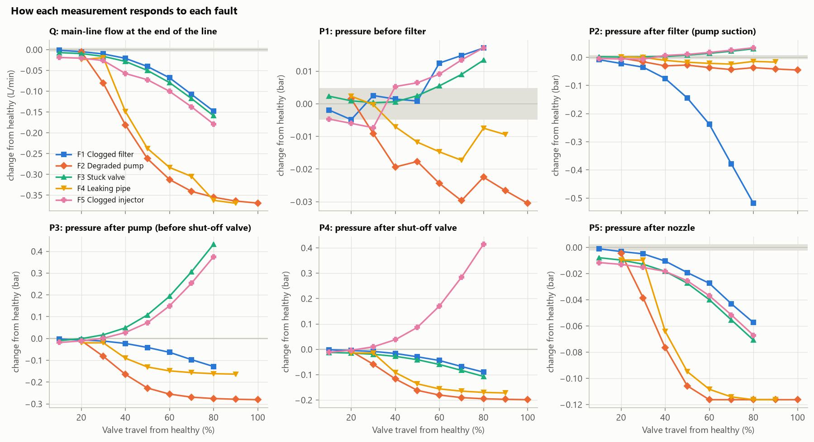
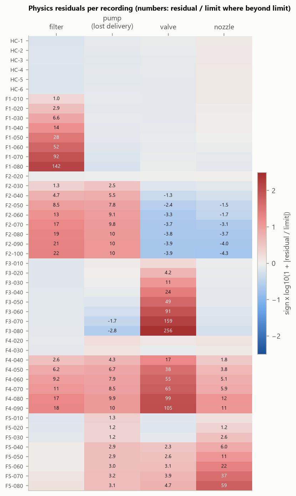
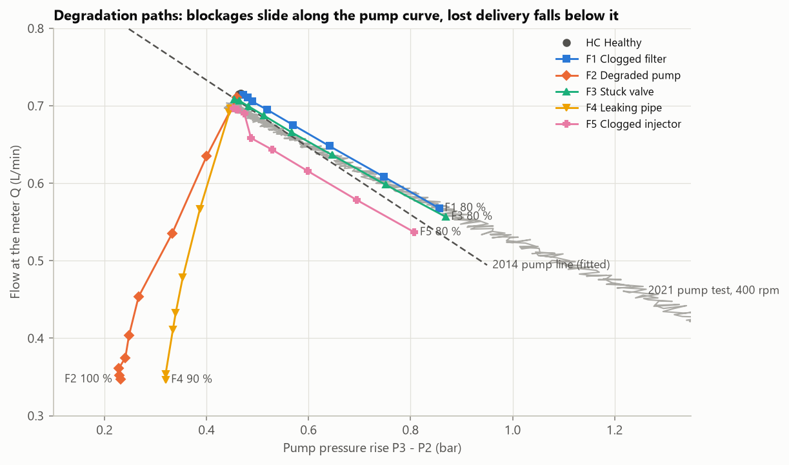
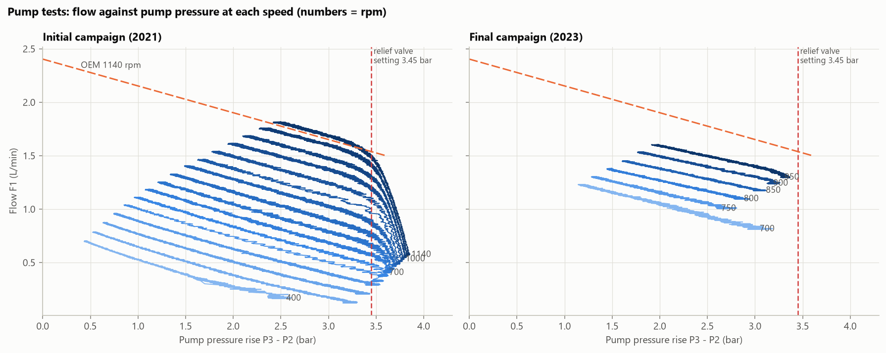
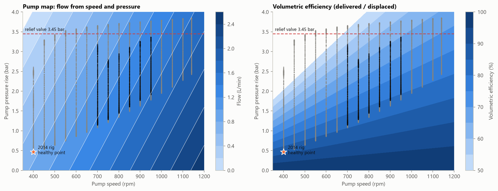
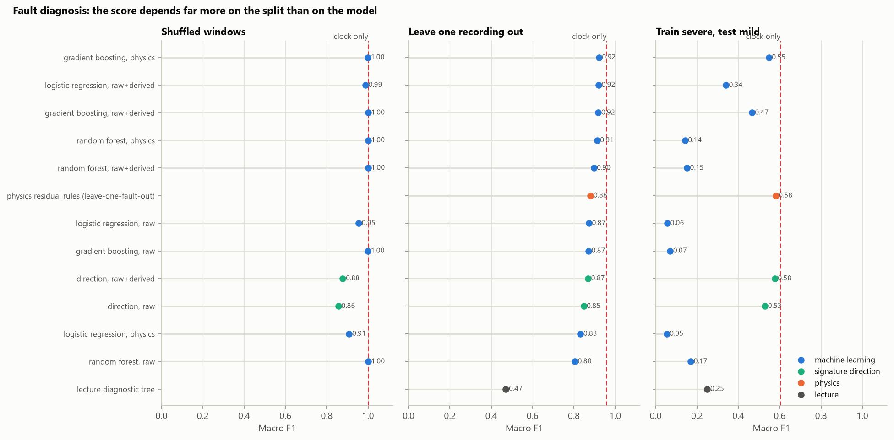
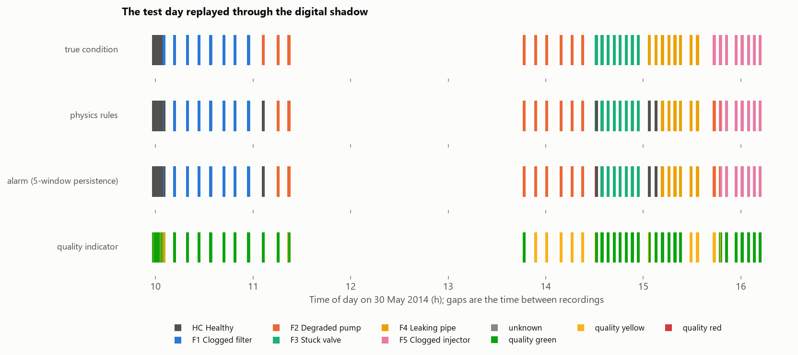

# A digital shadow of a fuel-system testbed: healthy and faulty behaviour, a gear-pump model, and the path to a digital twin

*Portfolio solution to the brief of Coursework 1, MMH126833 Digital Twins (Glasgow Caledonian
University). Analysis in Python; every number below is produced by the notebooks in `notebooks/`.*

## Summary

A laboratory fuel system was run healthy and with five emulated faults (clogged filter, degraded gear
pump, stuck shut-off valve, leaking pipe, clogged injector) at increasing severity. Its gear pump
(Oberdorfer N999R) was tested separately in two campaigns. This report:

* characterises the healthy system and shows that most of its high-frequency "noise" is the pump's own
  shaft and gear-mesh ripple (Task 2);
* builds physics-based health indicators that separate all five faults, including the filter/pump/leak
  group that the module's diagnostic tree leaves ambiguous (Task 3);
* shows the pump matches its datasheet within about 2 % and explains the initial campaign's flow
  collapse as its built-in relief valve. It then builds a two-parameter pump model and corrects the error
  figures in the module's own verification table (Task 4);
* assembles a digital shadow, replays the test day through it (no false alarms, 41/47 recordings
  correct), trains a classifier on simulated faults only and tests it on real data (macro F1
  0.87 +/- 0.03), and turns what failed into a specification for a digital twin (Task 5).

The most important finding is about evidence. Every fault condition was recorded in its own block of
the day, and **a classifier given only the time of day identifies the fault in 96 % of windows** with
each recording held out. On this dataset classifier accuracy is therefore cheap, and the trustworthy
results are the ones that cannot use time: the physics rules, calibrated without the fault being
scored, and the classifier trained on simulation.

---

## 1. The system and its failure modes (Task 1)

A gear pump draws water (standing in for fuel) from a main tank through a filter and delivers it through
a shut-off valve and a nozzle to a sump tank. Five pressure sensors, a flow meter **at the end of the
line** and a speed sensor monitor it. Proportional valves emulate the faults: three in series
(filter, shut-off valve, nozzle) restrict flow; two in parallel (a bypass at the pump discharge, a leak
after the valve) divert it.

The literature review (`docs/task1_literature_review.md`) covers mechanism, system effect, detection
and emulation fidelity for each fault:
* filter cake build-up with exponential late growth (Eker, Camci and Jennions, 2016);
* gear-pump clearance wear, with leakage rising with the cube of the gap (Guo et al., 2020);
* valve stiction (Choudhury, Thornhill and Shah, 2005);
* transient-based leak detection (Colombo, Lee and Karney, 2009);
* injector deposit formation (Birgel et al., 2008).

Two themes carry through the report:
* faults are located best by encoding where they sit in the hydraulic circuit;
* normal variation (temperature, tank level) competes with incipient faults.

## 2. Healthy behaviour (Task 2, notebook 02)

| Quantity (mean of 6 runs) | Value | Between-run sd |
|---|---|---|
| Flow at the end of the line | 0.716 L/min | 0.0004 |
| Pump pressure rise P3 - P2 | 0.467 bar | 0.0015 |
| Flow per revolution | 1.79 mL/rev | 0.001 |
| Drops: filter / valve / nozzle paths | 0.043 / 0.100 / 0.104 bar | < 0.001 |

* **Repeatability.** Recordings one minute apart agree to 0.06 % in flow. Healthy limits belong on
  1 s window means: raw 1 kHz samples give bands 2-14 times wider and would hide small faults.
* **Slow change.** P1 and P2 fall steadily from run to run (about 2.5 mbar in 5 min), tracking the
  falling main-tank level. It is physical, not a fault.
* **The noise is the pump.** About three quarters of the pressure fluctuation around the pump sits at
  the shaft frequency (6.67 Hz) and its second harmonic, with a further line at 80 Hz = 12x shaft speed,
  consistent with gear mesh. The speed controller hunts at 0.37 Hz. These are condition indicators in
  their own right, visible only because this rig sampled at 1 kHz (the later PLC logs every 200 ms).

## 3. Faulty behaviour (Task 3, notebook 03)

* Every fault lowers delivered flow, so flow detects but cannot isolate.
* The clogged filter drives suction pressure down (0.87 to 0.35 bar abs) while flow falls only 3 % up
  to 40 % valve travel.
* The stuck valve and the clogged injector both raise pump pressure; only P4, the sensor between them,
  separates them (it falls for the valve, rises for the nozzle).
* The pump bypass and the leak lower everything. The leak valve passes no flow at 20-30 % travel, and
  the bypass is nearly closed at 20 %: three recordings are labelled faulty but are physically healthy.

**Physics separates what raw pressures cannot.** Each pipe section obeys a pressure-flow law while its
component is healthy. Residuals against those laws, plus a pump residual (share of pump output not
reaching the meter), give each fault a distinct pattern. The key is the leak's position: leak flow still
passes through the shut-off valve, so the valve section's drop *rises* for a leak but falls for the pump
bypass. That resolves the lecture tree's F1/F2/F4 ambiguity group with the existing sensors. Every law
is fitted without any recording of the fault being scored.

**Degradation paths.** Blockages move the operating point along the pump curve; lost-delivery faults
move it below.

**Drift.** The mildest afternoon settings show *less flow at lower pump pressure* than the morning
baseline, i.e. the pump curve itself moved down by 1-3.5 %. Suction-side ripple also fell by about 30 %
for every afternoon recording. The most likely cause is the water warming (gear-pump slip scales with
1/viscosity); temperature was never measured. The healthy system therefore drifts by about as much as
the mildest faults, and the recording schedule ties that drift to the labels.

**The lecture's diagnostic tree on this data**: it isolates the stuck valve and the clogged injector
from 30-40 % travel. It leaves filter, pump and leak faults ambiguous, and its fixed P3 bands send the
strongest leaks to "clogged filter".

## 4. The N999R pump (Task 4, notebook 05)

* **Against the datasheet.** At 1140 rpm the tested pump is within 0-2.3 % of the OEM line (2.40 L/min
  at 0 bar, falling 0.25 L/min per bar). Displacement is about 2.1 mL/rev across the speed range.
* **Valve end points.** Initial campaign: every test closed the valves to 9.9 % open, so the end
  pressure rose with speed (2.6-3.86 bar), passing the relief setting from 550 rpm. Final campaign:
  25 % open at 700 rpm, 35 % at the other speeds, keeping every test at or below 3.37 bar.
* **Why the initial curves collapse above 600 rpm.** The N999**R** has a built-in relief valve set at
  50 psig = 3.45 bar. From 700 rpm the curves bend at 3.3-3.6 bar, and the flow diverted at the end of the
  test grows from 0.10 L/min at 700 rpm to 0.94 L/min at 1140 rpm. The final campaign stops short of
  the relief valve, so it maps the pump alone.

**Model.** Four forms were fitted to the final campaign:
* physics Q = D n / 1000 - k_s dP, with 2 or 3 parameters;
* a quadratic polynomial;
* a 2-D lookup table, which is the module's MATLAB/Simulink approach.

| Test | Physics (D, k_s) | Best alternative |
|---|---|---|
| Held-out speed, final campaign (mean abs error) | 1.1 % | lookup 0.6 % (no answer at 700 and 950 rpm) |
| 24 independent verification points (bias) | +3.4 % | all forms +3.4 to +3.6 % |
| 2021 campaign, 400-1140 rpm (bias) | +0.08 to +0.11 L/min | no form removes it |

The chosen model has **D = 2.11 mL/rev, k_s = 0.21 L/min/bar**. Inside the test envelope the model forms
differ by less than half a percentage point; **shifts between test days are roughly ten times larger**
(+3.5 % on the verification day, about +8 % against the 2021 campaign). The
shift lives in the slip, not the displacement (k_s = 0.21 in 2023, 0.27 in 2021, 0.25 on the
datasheet, with D unchanged). So the twin should hold D fixed and re-estimate k_s on the asset.

**A correction to the module notes.** The verification table's "Discrepancy [%]" column equals 0.990 x
the model flow in every row: it is a flow, not a percentage. From the table's own measured and model
columns, the published model over-predicts all 24 points by 1.9-5.3 % (mean 3.6 %), not under 1.52 %.

## 5. Fault diagnosis as a data-science problem (notebook 04)

1 s windows (2 820), six classes, three validation designs:

| Method (macro F1) | Shuffled windows | Leave one recording out | Train severe, test mild |
|---|---|---|---|
| Clock time only (shortcut probe) | 1.00 | 0.96 | 0.60 |
| Gradient boosting, physics residuals | 1.00 | 0.92 | 0.55 |
| Physics residual rules (never saw the fault) | - | 0.88 (0.94 without the 3 empty settings) | 0.58 |
| Signature direction (cosine to fault directions) | 0.88 | 0.87 | 0.58 |
| Logistic regression, raw pressures | 0.95 | 0.87 | 0.06 |
| Lecture diagnostic tree | - | 0.47 | 0.25 |

* Shuffled splits are meaningless (near-copies of each window sit in the training set).
* The clock alone matches or beats every sensor model on every split, because the schedule ties labels
  to time. A classifier's score here is not evidence of diagnosis.
* When trained on clear faults and tested on mild ones, standard classifiers collapse. Methods that use
  the *direction* of a deviation (physics rules, signature direction) hold up.
* Severity in physical units (resistance ratio, lost delivery) tracks valve travel with rank correlation
  0.97-0.99; an unseen setting is recovered to about 4.5 percentage points.

## 6. From digital shadow to digital twin (Task 5, notebook 06)

**The shadow.** It combines four parts:
* residuals and rules;
* a 5-window persistence filter on alarms;
* a second-opinion classifier;
* a green/yellow/red quality indicator (DNV-RP-A204, sec. 2.5).

Replayed over the whole day, it gave **no false alarms** and ended on the right condition for 41 of 47
recordings. The misses are the three settings with no physical effect (where "healthy" is correct), the
two mildest blockages, and F5 at 10 %, which drift made look like a pump fault. That one wrong
isolation was rated yellow in every window.

**Physics instead of fault data.** Following Ritto and Rochinha (2021), a steady-state network model of
the rig was assembled from the identified laws. It reproduces the recorded blockages within about
0.03 bar and was used to generate labelled synthetic faults with random drift and noise. A classifier
trained **only on simulation** scored on the real recordings:
* macro F1 **0.87 +/- 0.03** over five seeds (0.93 without the empty settings);
* 40-42 of 47 recordings correct.

This is the cleanest evidence of diagnostic skill in the project, because no real label or clock time
reaches it. Its healthy boundary is not yet qualified, though: 0-53 % of healthy windows are flagged
depending on the seed. The simulated noise and drift must be matched to reality before it can be
trusted on its own.

**What-if.** On this rig, delivery falls 5 % at about 4x filter resistance, while suction pressure only
nears 0.3 bar abs at about 26x. The filter residual sees clogging from about 1.4x, so filter changes can
be planned on resistance ratio. Raising pump speed restores flow for a bypass or leak but cannot rescue a
badly clogged filter (it would need sub-vacuum suction). Leaks call for isolation, not compensation.

**Specification.** `docs/task5_digital_twin_design.md` maps the twin onto Tao's five dimensions and
DNV-RP-A204 functional elements: filter, pump, line integrity, blockage location, and data quality.
Each FE has a capability target, a confidence level and a validation plan. The requirements come
straight from the shadow's failures:
* fluid temperature at the pump inlet, with slip modelled as k_s(T);
* atmospheric pressure, and a P5 range below zero gauge;
* a second flow meter at the pump outlet;
* at least 200 Hz sampling on P2/P3;
* a de-confounded fault-injection schedule with healthy runs through the day;
* a quality indicator on every output.

## 7. Extensions: regression models and live monitoring (notebooks 07-08)

**Regression (notebook 07).** The submitted coursework fitted a quadratic pump surface and reported
R^2 = 0.997 on a shuffled split. Judged on unseen speeds and other test days:

* **Degree.** Held-out error is lowest at degree 3, but degrees 3-5 are more than twice as wrong on the
  2021 campaign (0.21 against 0.08 L/min). Degree 2 is the better compromise; training R^2 cannot
  show this.
* **ML regressors.**
  * Random forest and gradient boosting cannot predict a speed they did not see (0.11 L/min error,
    about seven times the physics model).
  * The neural network is unstable at the edges.
  * A physics + Gaussian-process hybrid is as accurate as the best polynomials and adds prediction
    intervals. Those intervals cover 89 % of a held-out speed but none of another test day, because the
    day-to-day shift (about 0.05 L/min) is five times the within-day scatter. Alarm limits need a
    day-to-day term, which a fixed +/- 0.03 L/min does not provide.
* **Virtual flow meters.**
  * Each meter fails on the fault that breaks its assumption: the P4/P5 meter on the nozzle fault, the
    P5 physics meter where P5 clips.
  * A degree-2 polynomial meter extrapolates to errors of up to 3.3 L/min.
  * The twin should run several and vote. As a check on the flow meter itself, a 2 % bias is caught
    against recent healthy behaviour, but only about 10 % in absolute terms.
* **Severity regression.** Linear models recover the valve setting of an unseen recording to about
  4.7 points, matching the physics route; tree models are worst (9 points) because they cannot reach
  the extreme settings.

**Live monitoring (notebook 08).**

* **Healthy-only anomaly detection.** Mahalanobis, Isolation Forest, one-class SVM and an autoencoder
  all detect the clear faults. They also flag 100 % of the settings with no physical fault, and 2-22 %
  of a held-out healthy run. With a healthy reference covering five minutes they detect the time of day.
* **Change detection on a stream.** Consecutive recordings were joined, with healthy-to-healthy joins
  as controls; tuning used the controls only.
  * Hotelling T^2 with CUSUM, or Bayesian online change-point detection, catches every real step of
    degradation within about one second.
  * The Bayesian detector raised no false alarms and missed only a step with no physical change and one
    2 % step.
  * The main nuisance is the rig still settling (flow creeping by up to 1 %) at the start of some
    recordings.
* **Gradual degradation.** Simulated with the network model, alarms fire at 1-3 % extra resistance
  (filter about 10 %) or under 1 % lost flow, whatever the ramp speed. The simulation has no drift, and
  over hours the real rig drifts by about as much.
* **Kalman tracking.** Smoothing the four health indicators raises accuracy on the borderline recordings
  by 10-15 points with no new healthy errors. The tracked pump indicator also makes the afternoon drift
  visible as a sustained offset.

The extensions reinforce the main conclusion: the algorithms are not the bottleneck. What limits
detection is what the healthy reference covers and the missing temperature measurement.

## 8. Conclusions

1. The healthy rig is repeatable over minutes; its high-frequency content is pump ripple at shaft and
   mesh orders; its operating point drifts over hours by about as much as the mildest faults.
2. Encoding the circuit's physics separates all five faults with the existing sensors. It also gives
   severity in physical units and generalises to faults it never saw.
3. The N999R matches its datasheet; the initial campaign's collapse is the relief valve. Displacement is
   a constant of the pump; slip is its condition variable and shifts between days.
4. The dataset cannot support strong data-driven claims because labels are tied to time of day. A
   physics model can stand in for fault data, which is the strongest argument for building the twin
   around a calibrated virtual entity rather than a black-box classifier.
5. Flexible regressors (trees, neural networks, high-degree polynomials) fit the data they have and
   fail where conditions change; models that carry the physics, or are simple, hold up. Detection
   without labels works as change detection against recent behaviour, not as one-class modelling
   against a five-minute healthy reference.
6. The step from shadow to twin is mostly about data and assurance: temperature and reference
   pressure, de-confounded campaigns, qualified models with quality indicators, and constrained
   feedback actions. It is not about a more complex algorithm.

**Limitations.** One day of data at one speed; single faults only; emulated (not real) degradation;
steady-state models; healthy windows are scored by models whose calibration included them.

## References

See `docs/task1_literature_review.md` (failure modes) and `docs/task5_digital_twin_design.md` (digital
twins) for full lists. Key sources: Bardakis (2019); Birgel et al. (2008); Choudhury, Thornhill and Shah
(2005); Colombo, Lee and Karney (2009); DNV (2020) DNV-RP-A204; Eker, Camci and Jennions (2016);
Errandonea, Beltrán and Arrizabalaga (2020); Glaessgen and Stargel (2012); Grieves and Vickers (2017);
Guo et al. (2020); Kritzinger et al. (2018); Manring and Kasaragadda (2003); Niculita, Skaf and Jennions
(2014); Oberdorfer Pumps (n.d.); Ritto and Rochinha (2021); Tao, Zhang and Nee (2019).
