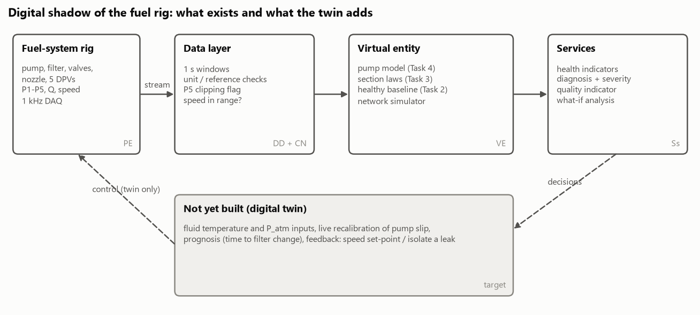

# Task 5 - From digital shadow to digital twin: design specification

**Brief:** appraise how the knowledge developed while building a digital shadow can evolve into the
design specifications of a digital twin of the fuel system.

This document turns the results of notebooks 02-06 into a specification. Every requirement is traced
to something the shadow measured or failed to do, so the design rests on evidence from this rig rather
than on generic digital-twin features.

## 1. What a digital twin means here

The literature agrees on the core and differs on the emphasis:

* Grieves and Vickers (2017): a physical product, a virtual product, and the data and information
  connection between them, kept together through the life cycle.
* Glaessgen and Stargel (2012), for NASA and the US Air Force: an integrated, multiphysics,
  probabilistic simulation of an *as-built* system that uses the best available models, sensor updates
  and fleet history to mirror the life of its physical twin.
* DNV-RP-A204 (DNV, 2020): a virtual representation of a system that calculates system states and
  makes information available, through integrated models and data, **to support decisions** over the
  life cycle.
* Kritzinger et al. (2018) separate the **digital model** (no automatic data exchange), the **digital
  shadow** (automatic flow from asset to model) and the **digital twin** (automatic flow both ways, the
  model can act on the asset). Their review found most published "twins" are shadows or models.
* Tao, Zhang and Nee (2019) extend Grieves's three parts to five dimensions: physical entity (PE),
  virtual entity (VE), services (Ss), twin data (DD) and connections (CN); Qi et al. (2021) catalogue
  the enabling technologies for each.

For maintenance, Errandonea, Beltrán and Arrizabalaga (2020) find that most twins support condition
monitoring and diagnosis, few reach prognosis, and validation on real assets is rare. Ritto and
Rochinha (2021) show how a physics-based model can generate the training data a twin's classifier
needs for damage states never observed. Bickford et al. (2020) and Madni, Madni and Lucero (2019) argue
that a twin should be specified from the system's engineering models from the start, not bolted on
after fielding.

Following DNV, this specification is organised around the **decisions** the twin supports, each one a
functional element (FE) with its own capability level, confidence level and quality indicator.

## 2. Where the shadow stands

| | Achieved in this project | Evidence |
|---|---|---|
| Integration level | digital shadow (offline replay of a recorded stream) | notebook 06 |
| Capability | level 2, diagnostic; first level-4 elements (what-if) | notebooks 04, 06 |
| Detection and isolation | 41/47 recordings correct, 0 false alarms; the misses are settings with no or minimal physical effect plus one drift case | notebook 06 |
| Physics-only training | classifier trained on simulated faults: macro F1 0.87 +/- 0.03 on real data; healthy boundary not yet qualified | notebook 06 |
| Component model | N999R model, D = 2.11 mL/rev, k_s = 0.21 L/min/bar, about 1 % on held-out speeds, about 3.5 % on independent points | notebook 05 |

## 3. Functional elements

DNV-RP-A204 sets a confidence level (1-3) from the consequence of a wrong decision and the time
available to check it. Capability: 1 descriptive, 2 diagnostic, 3 predictive, 4 prescriptive,
5 autonomous.

| FE | Key decision | Users | Capability now -> target | Confidence level | Main inputs |
|---|---|---|---|---|---|
| FE1 Filter condition | when to change the suction filter | maintenance planner | 2 -> 3 (time to limit) | 1: low consequence, days to act | filter resistance ratio, P2, Q, temperature |
| FE2 Pump health | is the pump wearing; when to overhaul | maintenance engineer | 2 -> 3 (slip trend) | 2: cost of an unplanned pump failure | k_s estimated online at known temperature, flow per revolution, ripple at shaft and mesh orders |
| FE3 Line integrity | is there a leak; isolate the line | operator | 2 -> 4/5 (isolate) | 3: fire risk, little time to act | lost-delivery residual, valve-section residual, second flow meter |
| FE4 Blockage location | valve or nozzle; which to inspect | maintenance engineer | 2 -> 3 | 1 | valve and nozzle residuals, P4 |
| FE5 Data and model quality | can the outputs above be trusted now | everyone (shown with every result) | 1 -> 2 | supports all | range and clipping checks, speed in range, model agreement, drift monitor |

FE3 is the only safety-relevant function. Its target of automatic isolation (level 5) falls outside
what DNV-RP-A204 alone covers; the RP states that autonomous safety-critical functions need additional
standards, so the twin should recommend isolation and leave the action to a certified protection
system.

## 4. Architecture (five dimensions)

### Physical entity: required changes to the rig

| Requirement | Reason (evidence) |
|---|---|
| R1 Fluid temperature at the pump inlet | pump delivery drifted 1-3.5 % through the test day (notebook 03) and slip differed by about 30 % between pump-test days (notebook 05); without temperature, wear and warm-up cannot be separated, and the drift caused the only false isolation (notebook 04) |
| R2 Atmospheric pressure, or all transducers on one reference | P1-P2 are absolute, P3-P5 gauge; the pump pressure rise mixes them with +/- 0.02 bar uncertainty (notebook 01) |
| R3 P5 range down to about -0.2 bar gauge | P5 clips at 0 bar in the strongest pump and leak faults, invalidating the nozzle residual (notebook 01) |
| R4 Second flow meter at the pump outlet | gives lost delivery directly and separates pump bypass from leak by mass balance (notebook 03, Task 1) |
| R5 Keep 1 kHz (at least 200 Hz) on P2 and P3 | 70-80 % of pressure fluctuation sits at shaft and gear-mesh orders (6.7, 13.3, 80 Hz); this is pump-condition information the later PLC's 200 ms period cannot see (notebook 02) |
| R6 Motor current or power | separates mechanical from hydraulic pump problems; recommended by Bardakis (2019) for the later rig |
| R7 Tank level | P1 tracks tank level (notebook 02); measure it rather than infer it |
| R8 Healthy reference across conditions | detectors trained on five minutes of healthy data flag every afternoon recording, including settings with no physical fault (notebook 08) |

### Twin data

* Raw stream at 1 kHz, 1 s feature windows, and recording metadata as a **data contract**: channel,
  unit, reference (gauge or absolute), range, calibration date. The 2014 files label two channels
  differently from their documentation and the pump files log flow as "bar" and time as zeros (notebook
  01).
* Constant "model" columns (temperature, viscosity, density) must not be stored as if measured.
* Fault-injection campaigns record the commanded setting **and** a schedule designed against
  confounding: healthy runs interleaved through the day, fault order randomised, each setting repeated.
  In the 2014 data, the time of day alone predicts the fault label with 96 % accuracy (notebook 04),
  which makes data-driven results unverifiable.

### Virtual entity

| Model | Form | Calibration | Update in operation |
|---|---|---|---|
| Pump | Q = D n / 1000 - k_s(T) dP; relief valve above 3.45 bar | D from pump tests (fixed); k_s(T) from healthy runs across temperatures | k_s re-estimated online at known T; its trend is the FE2 indicator |
| Pipe sections (filter, valve, nozzle, outlet) | dP = k Q^n | healthy data and other faults' data, never the scored fault | k tracked as resistance ratio (FE1, FE4) |
| Network simulator | steady-state solution of the joined laws | from the component models | used for what-if (FE1 limits, FE2/FE3 compensation) and to train classifiers |
| Healthy baseline | window means with within- and between-run scatter, as a function of T | repeated healthy runs across a day | re-recorded after maintenance or modification |
| Classifier (second opinion) | gradient boosting on raw pressures | trained only on simulated faults | retrain when the simulator is recalibrated |
| Pump interval model | physics + Gaussian process on the physics residual | final pump campaign | widen by a day-to-day term estimated from repeated healthy tests; within-day intervals alone cover 0 % of another day (notebook 07) |
| Virtual flow meters | P5 pipe law, linear P4/P5, tree models | other faults' data | run several and vote; a 2 % flow-meter bias is detectable against recent healthy behaviour (notebook 07) |
| Change detector and tracker | Hotelling T^2 with Bayesian change points; random-walk Kalman filter per indicator | healthy streams only | catches steps within about 1 s; tracking smooths borderline cases (notebook 08) |

### Services

Health indicators (four residuals), diagnosis with persistence, severity in physical units, quality
indicator per output, what-if analysis, and (target) prognosis and recommendations. The prognosis
service for FE1 should use the two-stage filter clogging model of Eker, Camci and Jennions (2016),
fitted to the filter resistance-ratio trend; for FE2, a trend on k_s at reference temperature.

### Connections

The later PLC testbed already exposes a Modbus TCP API for logging and control (Bardakis, 2019). The
twin connects to it for live data (shadow) and, at level 4-5, writes back speed set-points or isolation
requests. Two feedback actions were tested in the network model (notebook 06): raising pump speed
restores flow for a bypass or leak at modest pressure cost, but cannot compensate a badly clogged
filter (the suction pressure would have to go below vacuum). Actions must therefore be designed per
fault and constrained by suction pressure.

## 5. Verification and validation plan

Following DNV-RP-A204 section 5.5, each FE is accepted against stated criteria on data it was not
built from.

| Test | Method | Acceptance criterion (proposal) |
|---|---|---|
| False alarms | full-day healthy runs at 3+ fluid temperatures | no fault alarm; yellow quality below 10 % of windows |
| Detection limit | randomised severity sweeps, repeated 3 times | stated per fault in physical units, e.g. filter 1.5x resistance, 10 % lost delivery |
| Isolation | leave-one-fault-out and new-day test sets | at least 95 % of recordings above the detection limit isolated correctly |
| Shortcut check | classifier on time of day alone | must not beat chance; otherwise the campaign is confounded |
| Sim-to-real | train on simulation, test on real | healthy windows flagged below 2 %; macro F1 at least 0.9 |
| Pump model | independent verification points on a different day | bias within the scatter of repeated tests, after k_s(T) correction |

## 6. Operational assurance

* **Quality indicator**, shown with every result (DNV-RP-A204 section 2.5): green / yellow / red from
  data checks (range, clipping, speed in the calibrated range), model agreement (rules and classifier)
  and drift (pump residual in the ambiguous band). In the replay it flagged every window of the one
  wrong isolation (notebook 06).
* **Change management**: any maintenance (filter change, pump overhaul, new transducer) triggers
  re-recording of the healthy baseline and recalibration of the affected law.
* **Drift monitor**: k_s and the section resistances are tracked at reference temperature; slow drift
  without a fault pattern prompts recalibration rather than an alarm.

## 7. Roadmap

| Phase | Content | Capability gained |
|---|---|---|
| 1 Data | R1-R7; data contract; de-confounded fault campaign at several temperatures | trustworthy evidence |
| 2 Live shadow | stream from the PLC API; the residuals, rules and quality indicator from this project | level 2 diagnostic, live |
| 3 Predictive | k_s(T) model; filter clogging prognosis; detection limits validated | level 3 |
| 4 Prescriptive | what-if recommendations (speed set-point, isolate, schedule maintenance) with constraints | level 4 |
| 5 Twin | closed loop for non-safety actions; safety actions via certified protection | digital twin in Kritzinger's sense |

## 8. Limits of this appraisal

* All evidence comes from one day of 2014 data at one speed (400 rpm) plus two pump-test campaigns on
  the later testbed. Multiple simultaneous faults, which Bardakis (2019) identifies as the hard open
  problem, were not recorded.
* Faults are emulated, so the twin's knowledge of mechanisms (wear rates, clogging dynamics) comes from
  the literature, not from this rig.
* The section laws and the simulator are steady-state; transient leak signatures (Colombo, Lee and
  Karney, 2009) need a dynamic model.

## References

Bardakis, I. (2019) *A System-Level, Performance-Oriented Investigation of Degradation*. MSc
dissertation, Glasgow Caledonian University.

Bickford, J., Van Bossuyt, D.L., Beery, P. and Pollman, A. (2020) 'Operationalizing digital twins
through model-based systems engineering methods', *Systems Engineering*, 23, pp. 724-750.
doi:10.1002/sys.21559.

Colombo, A.F., Lee, P. and Karney, B.W. (2009) 'A selective literature review of transient-based leak
detection methods', *Journal of Hydro-environment Research*, 2(4), pp. 212-227.

DNV (2020, amended 2021) *DNV-RP-A204 Qualification and assurance of digital twins*. Recommended
practice. Høvik: DNV AS.

Eker, O.F., Camci, F. and Jennions, I.K. (2016) 'Physics-based prognostic modelling of filter clogging
phenomena', *Mechanical Systems and Signal Processing*, 75, pp. 395-412.

Errandonea, I., Beltrán, S. and Arrizabalaga, S. (2020) 'Digital Twin for maintenance: a literature
review', *Computers in Industry*, 123, 103316.

Glaessgen, E.H. and Stargel, D.S. (2012) 'The digital twin paradigm for future NASA and U.S. Air Force
vehicles', *53rd AIAA/ASME/ASCE/AHS/ASC Structures, Structural Dynamics and Materials Conference*.

Grieves, M. and Vickers, J. (2017) 'Digital twin: mitigating unpredictable, undesirable emergent
behavior in complex systems', in Kahlen, F.-J., Flumerfelt, S. and Alves, A. (eds) *Transdisciplinary
Perspectives on Complex Systems*. Cham: Springer, pp. 85-113.

Kritzinger, W., Karner, M., Traar, G., Henjes, J. and Sihn, W. (2018) 'Digital Twin in manufacturing:
a categorical literature review and classification', *IFAC-PapersOnLine*, 51(11), pp. 1016-1022.
doi:10.1016/j.ifacol.2018.08.474.

Madni, A.M., Madni, C.C. and Lucero, S.D. (2019) 'Leveraging digital twin technology in model-based
systems engineering', *Systems*, 7(1), 7. doi:10.3390/systems7010007.

Qi, Q., Tao, F., Hu, T., Anwer, N., Liu, A., Wei, Y., Wang, L. and Nee, A.Y.C. (2021) 'Enabling
technologies and tools for digital twin', *Journal of Manufacturing Systems*, 58, pp. 3-21.

Ritto, T.G. and Rochinha, F.A. (2021) 'Digital twin, physics-based model, and machine learning applied
to damage detection in structures', *Mechanical Systems and Signal Processing*, 155, 107614.
doi:10.1016/j.ymssp.2021.107614.

Singh, M., Fuenmayor, E., Hinchy, E.P., Qiao, Y., Murray, N. and Devine, D. (2021) 'Digital twin: origin
to future', *Applied System Innovation*, 4(2), 36. doi:10.3390/asi4020036.

Tao, F., Zhang, M. and Nee, A.Y.C. (2019) 'Five-dimension digital twin modeling and its key
technologies', in *Digital Twin Driven Smart Manufacturing*. London: Academic Press (Elsevier),
ch. 3.
